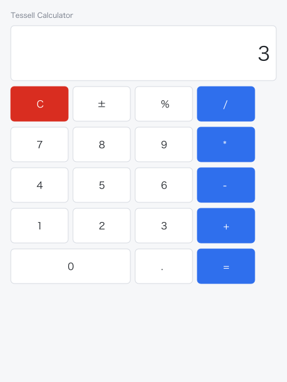
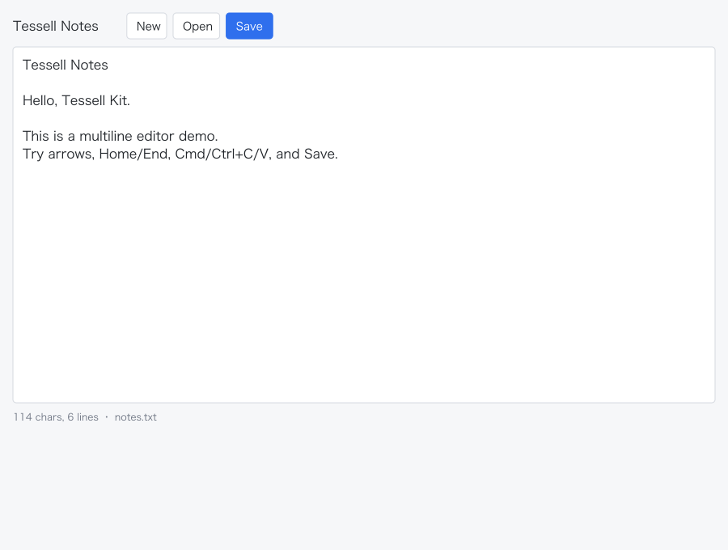

# 示例应用

两个可运行的 Kit app demo：计算器与多行文本编辑器。它们使用 SDL2 窗口 + OpenGL 宿主，组件与状态逻辑走 Tessell Kit；窗口宿主只存在于 `examples/`，不进入 shard 核心。

## 运行

macOS（Homebrew SDL2）：

```bash
./tools/run_kit_demo.sh examples/app_calculator.cr
./tools/run_kit_demo.sh examples/app_text_editor.cr
```

或手动：

```bash
crystal run examples/app_calculator.cr --link-flags "-L/opt/homebrew/lib"
```

Windows：安装 SDL2 开发库（msys2/ucrt64 或官方 dev 包），确保 `SDL2.dll` 在 PATH 或 exe 同目录，然后：

```powershell
crystal run examples/app_calculator.cr
```

无窗口预览：

```bash
crystal run tools/kit_app_previews.cr
# 输出 site/previews/calculator-app.svg 与 text-editor-app.svg
```

## 计算器



- 四则运算、小数、正负号、百分比、退格、清空。
- 鼠标点击按钮；键盘数字与 `+ - * /`；Enter 求值；Esc/C 清空；Backspace 退格。
- 状态在 `TessellApps::CalculatorState`，UI 在 `CalculatorApp`；不依赖 SDL 可单独测试。

代码：[examples/app_calculator.cr](https://github.com/ShiningRay/tessell/blob/main/examples/app_calculator.cr)、[examples/apps/calculator_app.cr](https://github.com/ShiningRay/tessell/blob/main/examples/apps/calculator_app.cr)。

## 文本编辑器



- 多行编辑、光标/选区、横向/纵向滚动、Home/End、方向键、Shift 选区。
- Cmd/Ctrl+A/C/X/V 通过 `Kit::Clipboard`；SDL 宿主注入系统剪贴板。
- New/Open/Save 操作当前目录的 `notes.txt`；打开后编辑器自动获得焦点。
- 多行 `EditorView` 是 demo 级组件，复用 `Kit::TextEditing` 的 grapheme 光标/删除；不是 Kit 公共组件。

代码：[examples/app_text_editor.cr](https://github.com/ShiningRay/tessell/blob/main/examples/app_text_editor.cr)、[examples/apps/text_editor_app.cr](https://github.com/ShiningRay/tessell/blob/main/examples/apps/text_editor_app.cr)。

## 宿主与验证

- SDL 宿主：[examples/lib/kit_sdl_host.cr](https://github.com/ShiningRay/tessell/blob/main/examples/lib/kit_sdl_host.cr)。
- 文本渲染走核心 FreeType/HarfBuzz + `GLBackend`；本次同时修正 FreeType `FT_Long`/`FT_Pos` 的 LP64 布局，macOS 已实测测字、栅格化与上屏。
- `GLPainter` 把 Kit 形状命令交给 `GLBackend#draw_draw_list`，文本用 `TextRenderer` + atlas 批次。
- 逻辑测试：`crystal spec spec/apps`。
- 真实窗口自动跑 2 帧并截图：

```bash
crystal run examples/app_calculator.cr --link-flags "-L/opt/homebrew/lib" -- \
  --frames=3 --screenshot=/tmp/calculator.ppm
ffmpeg -y -i /tmp/calculator.ppm /tmp/calculator.png
```

## 限制

- SDL2 只是 demo 宿主；核心仍不依赖 SDL2。Windows 上需要单独安装 SDL2。
- 未接平台 IME composition；SDL_TEXTINPUT 可输入普通文本，但复杂输入法状态未验证。
- 未接屏幕阅读器 provider；只有进程内 A11y 树。
- 文本编辑器 Save/Open 固定 `notes.txt`，没有撤销/重做、查找替换、自动换行与多文档。
- 真实窗口证据来自 macOS SDL2/OpenGL；Windows 窗口仍待验证。
